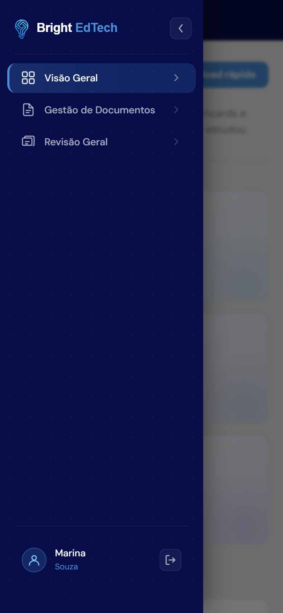
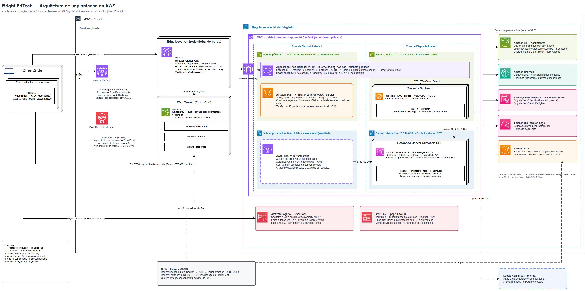
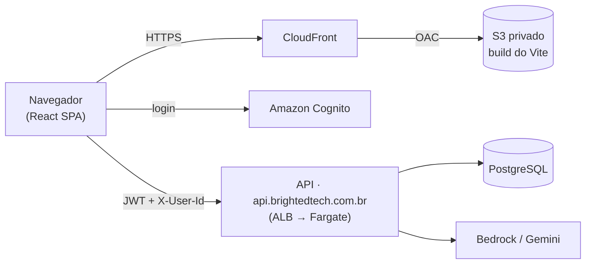

<div align="center">

# 💡 Bright EdTech — Front-end

**Estude com propósito: envie seus PDFs, gere resumos, flashcards e quizzes com IA e revise na hora certa.**


[Plataforma](https://brightedtech.com.br) · [Repositório do back-end](https://github.com/joaopedro-albuquerque/bright-edtech-backend)


</div>

> Projeto de conclusão do curso de **Análise e Desenvolvimento de Sistemas (IFSP)**, construído por um time de quatro estudantes.
> Este repositório é o **front-end** (SPA em React). A API, a IA e a infraestrutura ficam no [repositório do back-end](https://github.com/joaopedro-albuquerque/bright-edtech-backend).

---

## O que a plataforma faz

O aluno envia o material em PDF e a **Bright** transforma esse conteúdo em ferramentas de estudo:

| | |
|---|---|
| 📄 **Resumos** | Três métodos: Resumo Executivo, Método Cornell e Fichamento Acadêmico. Lidos na tela (Markdown formatado) ou baixados em PDF |
| 🃏 **Flashcards** | Cartões de pergunta e resposta gerados do próprio documento, com quantidade e dificuldade configuráveis |
| ❓ **Quizzes** | Questões de múltipla escolha para autoavaliação |
| 🔁 **Revisão espaçada** | A cada cartão ou questão o aluno avalia *Errei · Difícil · Bom · Fácil*; o algoritmo SM-2 agenda a próxima revisão e a tela de **Revisão Geral** mostra o que está atrasado e o que está em dia |
| 🗂️ **Organização** | Pastas e subpastas, renomear, excluir, visualizar o PDF original |

## Telas

<table>
  <tr>
    <td width="50%"><br><sub><b>Visão Geral</b> — métricas, geração rápida de resumo e atividade recente</sub></td>
    <td width="50%"><br><sub><b>Gestão de Documentos</b> — pastas, arquivos e contadores de resumos, flashcards e quizzes</sub></td>
  </tr>
  <tr>
    <td width="50%"><br><sub><b>Revisão Geral</b> — itens atrasados e em dia, com aviso de conteúdo gerado por IA</sub></td>
    <td width="50%" align="center">
      
      <br>
      <sub><b>Mobile</b> — interface adaptada e menu lateral em gaveta</sub>
    </td>
  </tr>
</table>

> As capturas usam dados de demonstração.

---

## Destaques de engenharia e experiência

- **Tour guiado integrado.** No primeiro acesso, um tour apresenta a plataforma percorrendo as quatro telas em sequência (Visão Geral → Documentos → Revisão Geral → Perfil). Só é marcado como concluído no servidor quando o aluno chega ao fim ou o encerra de propósito, então quem sai no meio volta a vê-lo. Foi ajustado para funcionar também no celular, abrindo o menu lateral no passo certo.
- **Responsivo de verdade.** Breakpoints padronizados (480 / 640 / 768 / 1024 px), menu lateral que vira gaveta no celular, uso de `dvh` para respeitar a barra do navegador móvel e modais que nunca ficam atrás de outros elementos.
- **Erros que o usuário entende.** Falhas do servidor (arquivo grande demais, PDF escaneado, conteúdo não permitido, IA indisponível) viram *pop-ups* claros, com o texto vindo do código de erro da API.
- **Validação antes de enviar.** O PDF é checado no navegador (formato e tamanho de até 5 MB) antes do upload, poupando tempo e requisições. Validações de conteúdo ficam no servidor.
- **Privacidade e LGPD.** Aceite versionado dos Termos de Uso e da Política de Privacidade no cadastro e exclusão de conta completa pela própria tela de perfil (apaga dados e arquivos).
- **Transparência sobre a IA.** Aviso permanente de que o conteúdo é gerado por inteligência artificial e pode conter imprecisões.
- **Acessibilidade e desempenho auditados.** Script que roda **Lighthouse** e **axe** nas páginas públicas e gera relatório (`npm run audit:usability`).
- **Autenticação gerenciada.** Login, cadastro e recuperação de senha com **Amazon Cognito** (AWS Amplify), com rotas privadas protegidas.

---

## Arquitetura



O front-end é um **site estático**: o build do Vite é publicado em um bucket S3 **privado**, servido globalmente pelo **CloudFront** (HTTPS, HTTP/2, acesso ao bucket só via OAC) nos domínios `brightedtech.com.br` e `www`. O navegador conversa diretamente com o **Cognito** (login) e com a **API** em `api.brightedtech.com.br` (ALB → ECS Fargate), enviando o JWT em cada chamada.



---

## Rotas

| Rota | Acesso | Tela |
|---|---|---|
| `/` | pública | Landing page |
| `/login` · `/signup` · `/forgot-password` | pública | Autenticação |
| `/dashboard` | privada | Visão Geral |
| `/documents` | privada | Gestão de Documentos |
| `/revisao-geral` | privada | Flashcards & Quizzes (Revisão Geral) |
| `/profile` | privada | Perfil, preferências e exclusão da conta |

Rotas privadas redirecionam para `/login` quando não há sessão.

## Stack

| Área | Tecnologias |
|---|---|
| UI | React 19, React Router 7, CSS por componente (sem framework de UI) |
| Build | Vite 8, ESLint 10 |
| Autenticação | AWS Amplify (Cognito) |
| Conteúdo | `react-markdown` + `remark-gfm` (resumos), `@lottiefiles/dotlottie-react` (animações) |
| Onboarding | `react-joyride` |
| Qualidade | Lighthouse e `@axe-core/cli` |
| Hospedagem | S3 + CloudFront (OAC), deploy por GitHub Actions |

---

## Como rodar localmente

**Pré-requisitos:** Node.js 20+ e npm.

```bash
npm install --legacy-peer-deps
npm run dev
```

Abra `http://localhost:5173`. Por padrão o front usa a API e o Cognito de produção; para apontar para outro ambiente, crie um `.env`:

| Variável | Padrão | Para quê |
|---|---|---|
| `VITE_API_BASE` | `https://api.brightedtech.com.br` | URL da API |
| `VITE_COGNITO_USER_POOL_ID` | pool de produção | User Pool do Cognito |
| `VITE_COGNITO_USER_POOL_CLIENT_ID` | client de produção | App client do Cognito |
| `VITE_COGNITO_REGION` | `us-east-1` | Região do Cognito |

> A API só aceita requisições de origens liberadas no CORS; em desenvolvimento, use a porta `5173`.

**Com Docker**

```bash
docker build -t bright-edtech-front .
docker run -p 5173:5173 bright-edtech-front
```

## Scripts

| Comando | O que faz |
|---|---|
| `npm run dev` | Servidor de desenvolvimento com *hot reload* |
| `npm run build` | Build de produção em `dist/` |
| `npm run preview` | Serve o build localmente |
| `npm run lint` | Análise estática com ESLint |
| `npm run audit:usability` | Lighthouse + axe nas páginas públicas (gera relatório em `audits/`) |

## Deploy

O workflow **Deploy Frontend** (GitHub Actions, manual) faz o build, sincroniza `dist/` com o bucket S3 e **invalida o cache do CloudFront**, publicando a nova versão sem downtime. O workflow **Quality** roda a auditoria de acessibilidade e desempenho contra o site publicado.

## Estrutura do projeto

```
src/
├── pages/          # telas (Landing, Login, Signup, Overview, Documents, Flashcards & Quizzes, Profile)
├── components/     # layout do dashboard + tour, menu lateral, modais, upload, estudo, landing
├── utils/          # validação de PDF e tradução dos erros da API
├── constants/      # formatos de resumo
├── config.js       # URL da API e configuração do Cognito
└── App.jsx         # rotas e proteção de rotas privadas
docs/img/           # capturas de tela e diagrama de arquitetura
scripts/            # auditoria de usabilidade (Lighthouse + axe)
```

## Time

Projeto desenvolvido por **Eric, João, Miguel e Gabriela**, estudantes de Análise e Desenvolvimento de Sistemas no IFSP.

> ⚠️ Conteúdos gerados por inteligência artificial podem conter imprecisões. Confira sempre com o material original antes de usá-los como única fonte de estudo.
