<div align="center">

# Bright EdTech

**Plataforma de estudo que transforma PDFs em resumos, flashcards e quizzes e organiza as revisões no momento certo.**


[Acessar a plataforma](https://brightedtech.com.br) · [Repositório do back-end](https://github.com/joaopedro-albuquerque/bright-edtech-backend)


</div>

## Índice

- [Sobre](#sobre)
- [Como a plataforma ajuda](#como-a-plataforma-ajuda)
- [Funcionalidades](#funcionalidades)
- [Telas](#telas)
- [Como funciona](#como-funciona)
- [Revisão espaçada](#revisão-espaçada)
- [Arquitetura](#arquitetura)
- [Tecnologias](#tecnologias)
- [Rotas da aplicação](#rotas-da-aplicação)
- [Estrutura do projeto](#estrutura-do-projeto)
- [Executando localmente](#executando-localmente)

## Sobre

A Bright EdTech é uma aplicação web para quem estuda a partir de documentos. O estudante envia um PDF e a plataforma gera, com inteligência artificial, resumos, flashcards e quizzes do próprio material, além de agendar as revisões com base em repetição espaçada.

Este repositório contém o **front-end**, uma aplicação de página única (SPA) em React. A API e a infraestrutura estão no [repositório do back-end](https://github.com/joaopedro-albuquerque/bright-edtech-backend).

## Como a plataforma ajuda

| Situação | O que a plataforma oferece |
|---|---|
| Materiais espalhados em vários lugares | Pastas e subpastas, busca por nome e visualizador de PDF na própria plataforma |
| Pouco tempo para preparar material de estudo | Resumos, flashcards e quizzes gerados a partir do PDF em poucos segundos |
| Esquecer o conteúdo depois de ler | Revisões agendadas no momento em que o conteúdo começa a ser esquecido |
| Não saber o que revisar primeiro | Tela de revisão com os itens atrasados em destaque, agrupados por documento |
| Estudar pelo celular | Interface adaptada a telas pequenas, com menu lateral em gaveta |

## Funcionalidades

- **Resumos em três formatos:** Executivo (tópicos diretos), Cornell (perguntas-gatilho ao lado das respostas) e Fichamento acadêmico (citações, metodologia e apreciação crítica). Leitura na tela ou download em PDF.
- **Flashcards:** cartões de pergunta e resposta gerados do documento, com quantidade e dificuldade configuráveis.
- **Quizzes:** questões de múltipla escolha com correção e resumo do desempenho.
- **Revisão espaçada:** o estudante avalia cada item de 1 a 5 e a próxima revisão é agendada automaticamente.
- **Organização:** pastas e subpastas, trilha de navegação, renomear, excluir e visualizar o PDF original.
- **Busca:** localiza pastas e documentos pelo nome e mostra o caminho de cada resultado.
- **Tour guiado:** apresentação das telas no primeiro acesso.
- **Privacidade:** aceite versionado dos termos de uso e exclusão completa da conta, com dados e arquivos.
- **Aviso sobre IA:** o conteúdo gerado é sempre identificado como tal.

## Telas

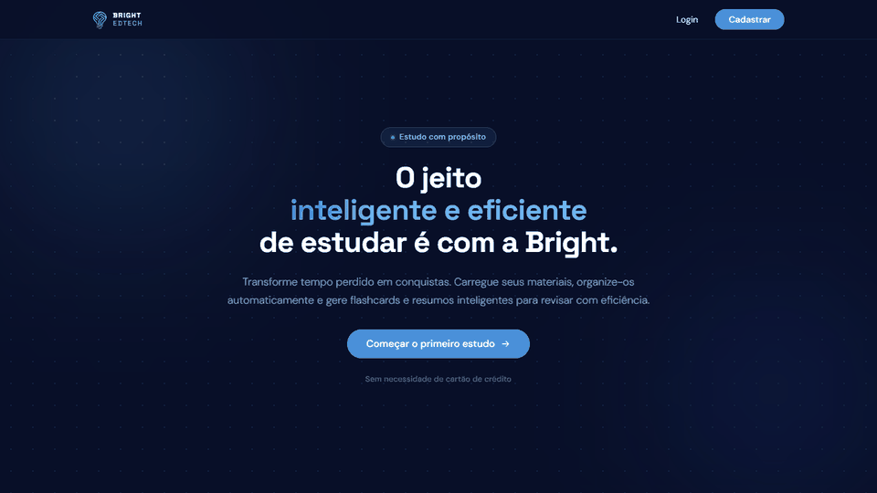

<table>
  <tr>
    <td width="50%">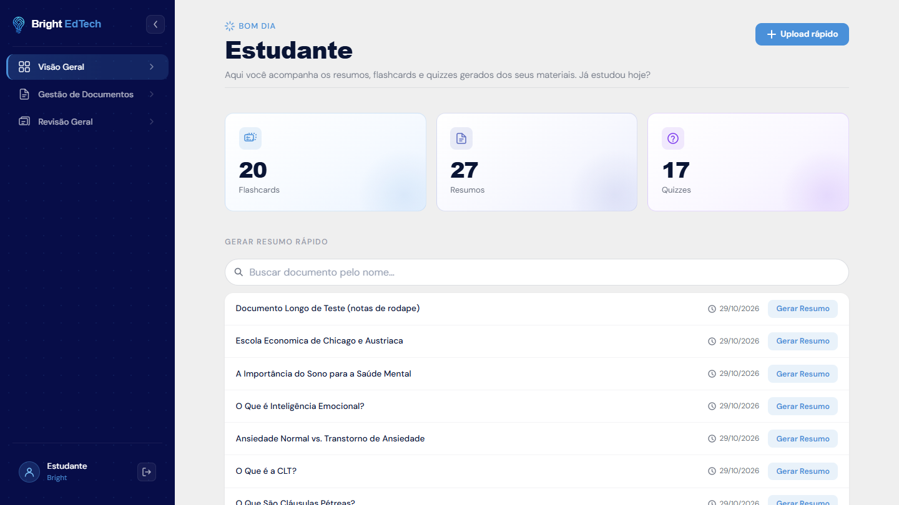<br><sub><b>Visão geral:</b> métricas, geração rápida de resumo e atividade recente</sub></td>
    <td width="50%">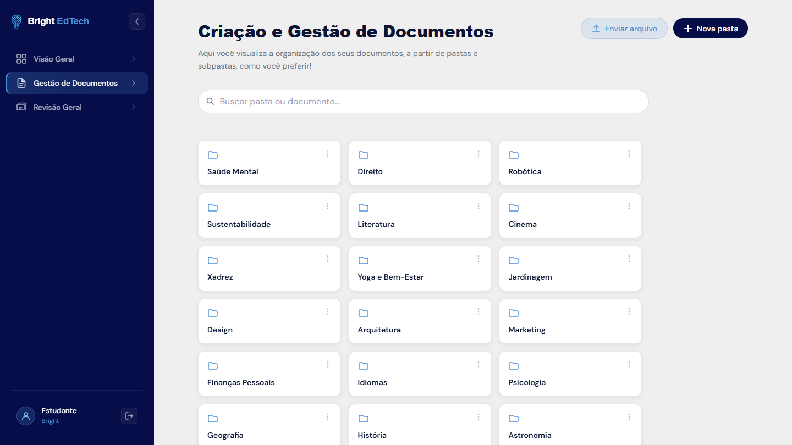<br><sub><b>Documentos:</b> pastas e subpastas com busca</sub></td>
  </tr>
  <tr>
    <td width="50%">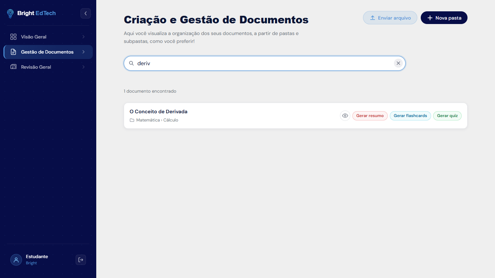<br><sub><b>Busca:</b> resultados com o caminho da pasta e atalhos de geração</sub></td>
    <td width="50%">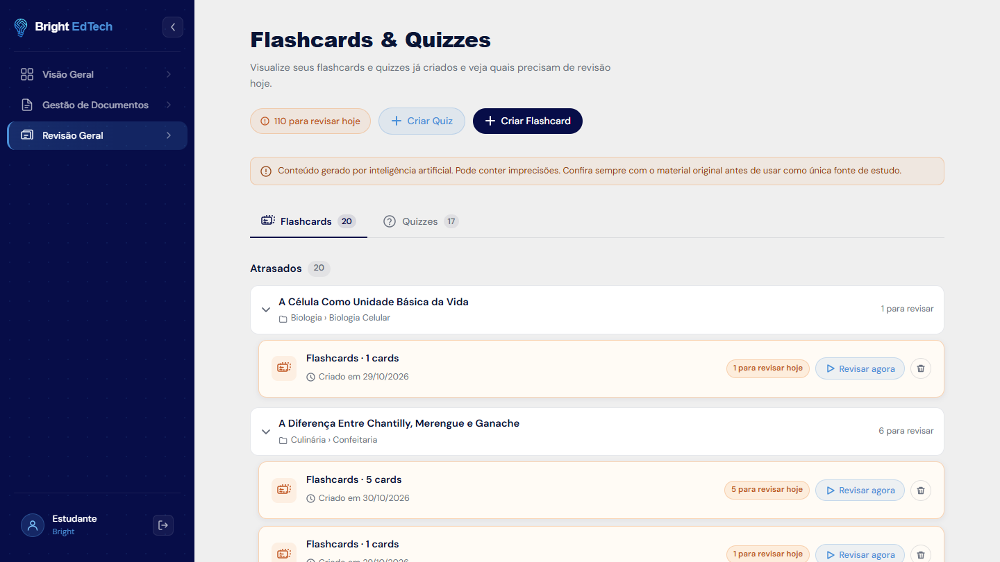<br><sub><b>Revisão geral:</b> itens atrasados agrupados por documento</sub></td>
  </tr>
  <tr>
    <td width="50%">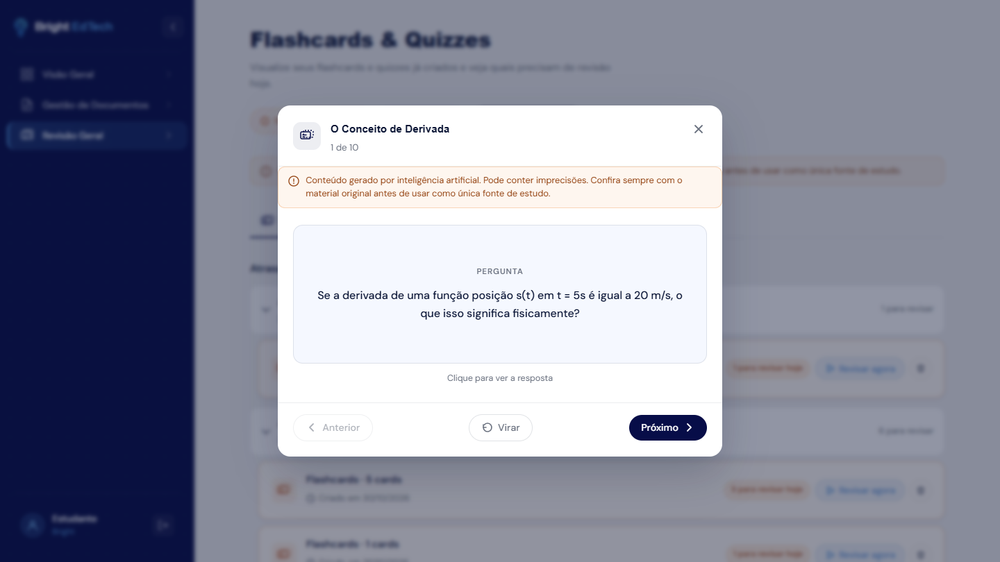<br><sub><b>Estudo:</b> pergunta do flashcard</sub></td>
    <td width="50%">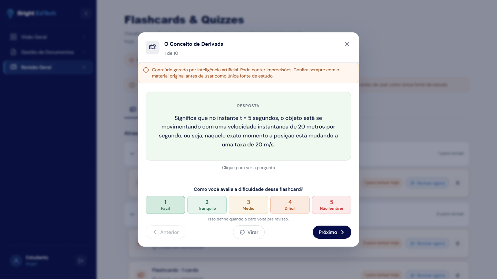<br><sub><b>Estudo:</b> resposta e avaliação de 1 a 5</sub></td>
  </tr>
</table>

<p align="center">
  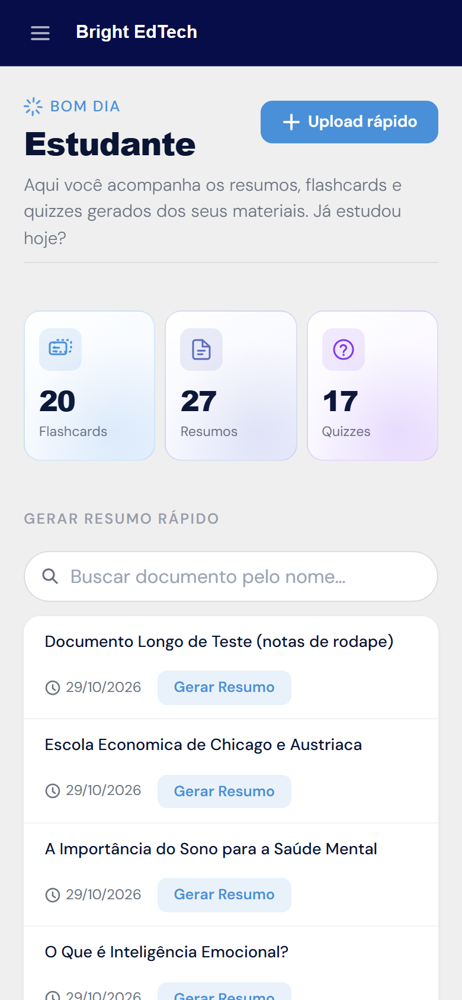
  &nbsp;&nbsp;
  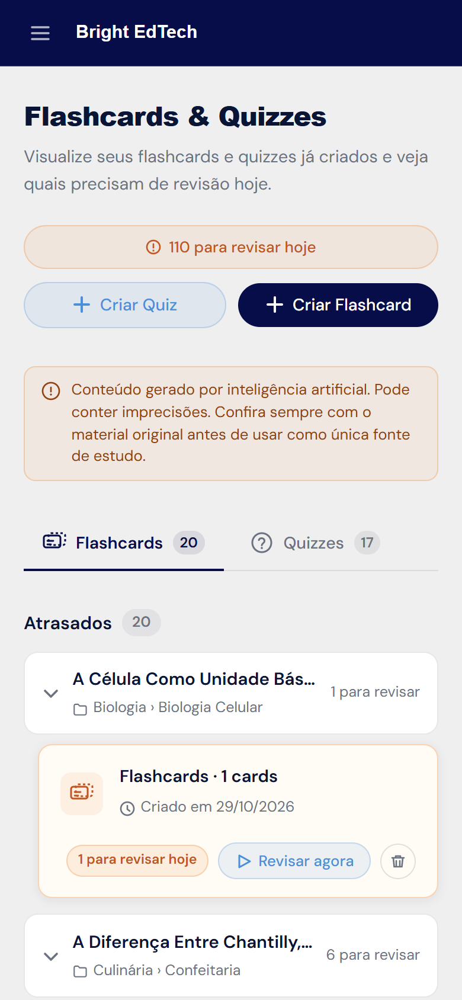
</p>

## Como funciona

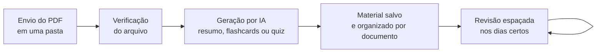

1. O estudante envia um PDF e escolhe a pasta de destino.
2. O arquivo é verificado (formato, tamanho e conteúdo permitido).
3. A IA gera o material escolhido (formato do resumo, quantidade e dificuldade).
4. O material fica associado ao documento, na pasta correspondente.
5. A tela de revisão mostra o que precisa ser estudado em cada dia.

## Revisão espaçada

Cada flashcard e cada questão tem o seu próprio calendário de revisão, calculado pelo algoritmo **SM-2**. A cada avaliação, o intervalo até a próxima revisão aumenta ou diminui conforme o desempenho.

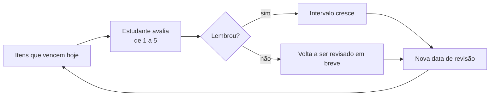

## Arquitetura

O front-end é um site estático publicado em um bucket privado do Amazon S3 e entregue pelo Amazon CloudFront. O login é feito diretamente no Amazon Cognito e as demais chamadas vão para a API, com o token JWT em cada requisição.

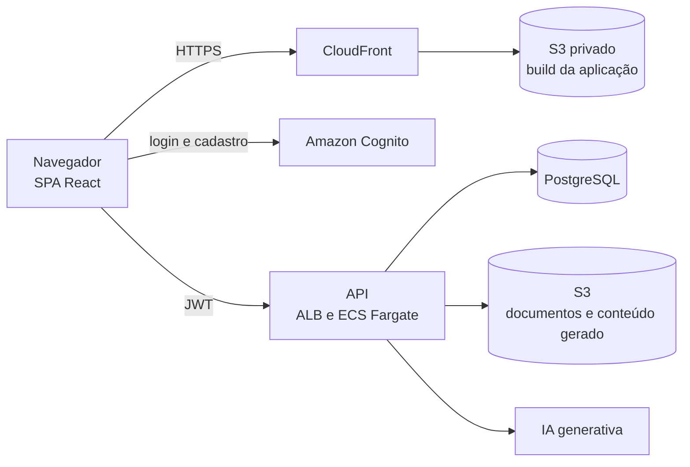

Detalhes da API, do modelo de dados e da infraestrutura estão no [repositório do back-end](https://github.com/joaopedro-albuquerque/bright-edtech-backend).

## Tecnologias

| Área | Tecnologias |
|---|---|
| Interface | React 19, React Router 7, CSS por componente |
| Build | Vite 8, ESLint 10 |
| Autenticação | AWS Amplify (Amazon Cognito) |
| Conteúdo | `react-markdown` e `remark-gfm` (resumos), `@lottiefiles/dotlottie-react` (animações) |
| Onboarding | `react-joyride` |
| Qualidade | Lighthouse e axe (`npm run audit:usability`) |
| Hospedagem | Amazon S3 e CloudFront, com deploy por GitHub Actions |

## Rotas da aplicação

| Rota | Acesso | Tela |
|---|---|---|
| `/` | pública | Página inicial |
| `/login`, `/signup`, `/forgot-password` | pública | Autenticação |
| `/dashboard` | privada | Visão geral |
| `/documents` | privada | Gestão de documentos |
| `/revisao-geral` | privada | Flashcards e quizzes, com a revisão geral |
| `/profile` | privada | Perfil, preferências e exclusão da conta |

Rotas privadas redirecionam para `/login` quando não há sessão.

## Estrutura do projeto

```
src/
├── pages/          # telas da aplicação
├── components/     # layout, menu lateral, modais, upload, estudo e página inicial
├── utils/          # validação de PDF e tradução dos erros da API
├── constants/      # formatos de resumo
├── config.js       # URL da API e configuração do Cognito
└── App.jsx         # rotas e proteção de rotas privadas
docs/img/           # imagens e animações deste README
scripts/            # auditoria de usabilidade (Lighthouse e axe)
```

## Executando localmente

Requisitos: Node.js 20 ou superior e npm.

```bash
npm install --legacy-peer-deps
npm run dev
```

A aplicação abre em `http://localhost:5173`. Para apontar para outro ambiente, crie um arquivo `.env`:

| Variável | Para que serve |
|---|---|
| `VITE_API_BASE` | URL da API |
| `VITE_COGNITO_USER_POOL_ID` | User Pool do Cognito |
| `VITE_COGNITO_USER_POOL_CLIENT_ID` | App client do Cognito |
| `VITE_COGNITO_REGION` | Região do Cognito |

Outros comandos:

| Comando | O que faz |
|---|---|
| `npm run build` | Gera o build de produção em `dist/` |
| `npm run preview` | Serve o build localmente |
| `npm run lint` | Análise estática com ESLint |
| `npm run audit:usability` | Auditoria de acessibilidade e desempenho |

Com Docker:

```bash
docker build -t bright-edtech-front .
docker run -p 5173:5173 bright-edtech-front
```

---

<sub>Projeto acadêmico do curso de Análise e Desenvolvimento de Sistemas do Instituto Federal de São Paulo (IFSP). Conteúdos gerados por inteligência artificial podem conter imprecisões e devem ser conferidos com o material original.</sub>
